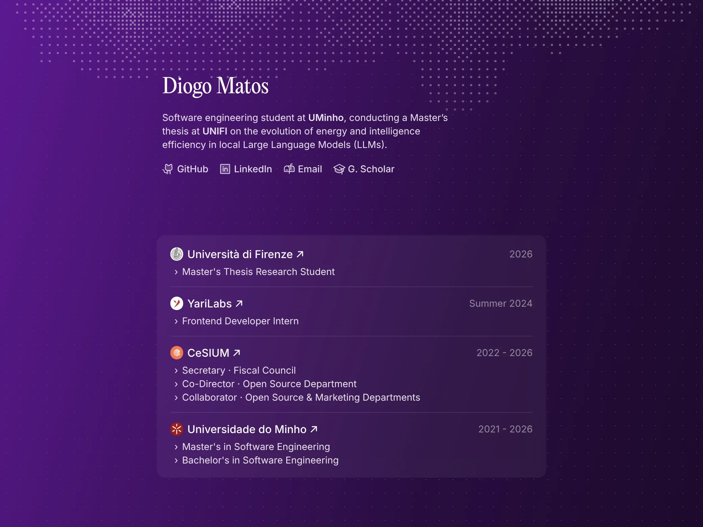

# 🪄 diogogmatos.dev

> My little corner of the internet: [diogogmatos.dev](https://diogogmatos.dev) 🔗

  

Part portfolio, part blog, part excuse to play with fun web stuff. ✨

## 🍬 What's Inside

- 🌌 **An aurora that follows your cursor**: a dithered canvas of white pixels at the top of the home page, with a glow that chases your mouse around.
- 🌈 **A background that never sits still**: a gradient that slowly drifts through the rainbow, over a subtle grid of dots.
- 🎠 **Project showcases**: carousels mixing videos, screenshots and phone mockups, each of them a story in the blog.
- ✍️ **A blog written in MDX**: with custom components to make posts more fun to read, like timelines, tech chips, stat cards and bar charts.
- 🔍 **Search**: find any post by its title, summary or date.
- 🖼️ **Custom link previews**: every page gets its own Open Graph image, generated on the fly, and blog posts use their cover as the background.

## 🧰 Built With

- [Next.js](https://nextjs.org), [React](https://react.dev) and [TypeScript](https://www.typescriptlang.org)
- [Tailwind CSS](https://tailwindcss.com) for styling, and [Motion](https://motion.dev) for the animations
- [Content Collections](https://www.content-collections.dev) for the blog posts, projects and experiences, with [MDX](https://mdxjs.com) for the posts
- [Embla Carousel](https://www.embla-carousel.com) for the project carousels
- [Phosphor Icons](https://phosphoricons.com) for (almost) every icon
- [sharp](https://sharp.pixelplumbing.com) to generate the link preview images
- [Umami](https://umami.is) and [Vercel Analytics](https://vercel.com/analytics), to see if anyone's actually reading 👀

---

proudly developed and designed by me 🖌️

